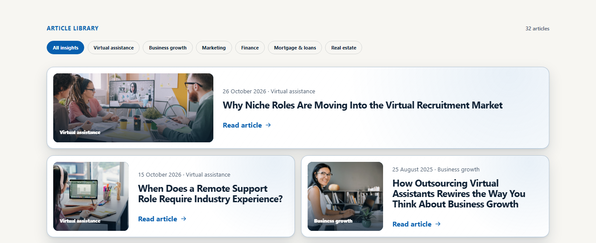
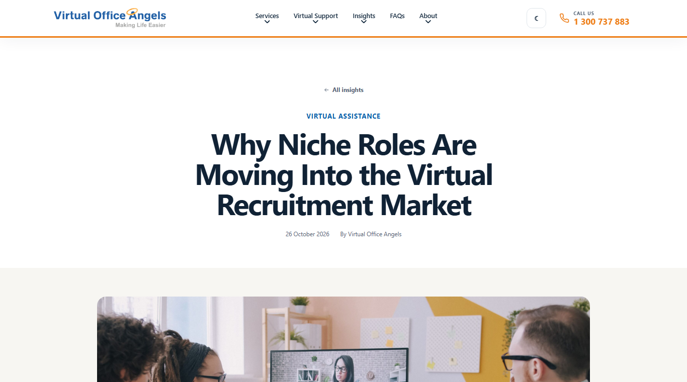
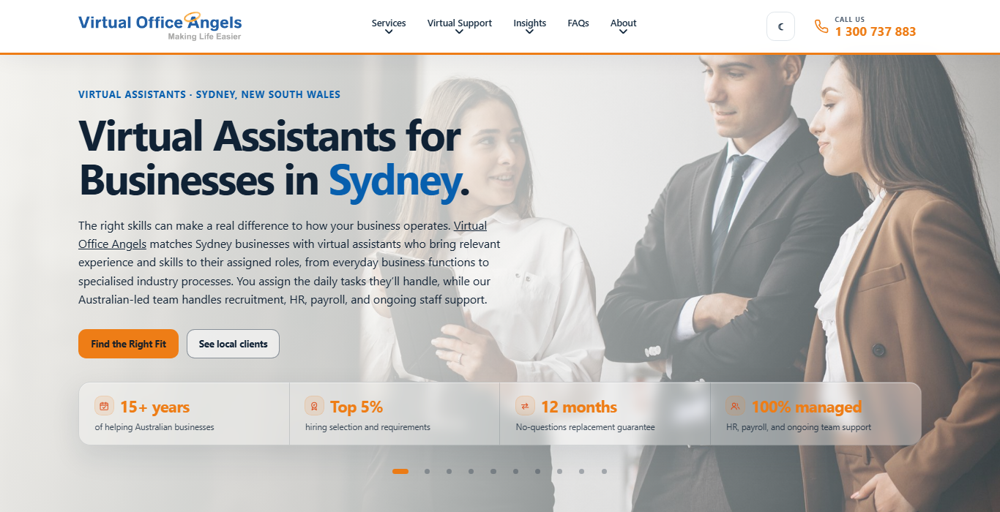
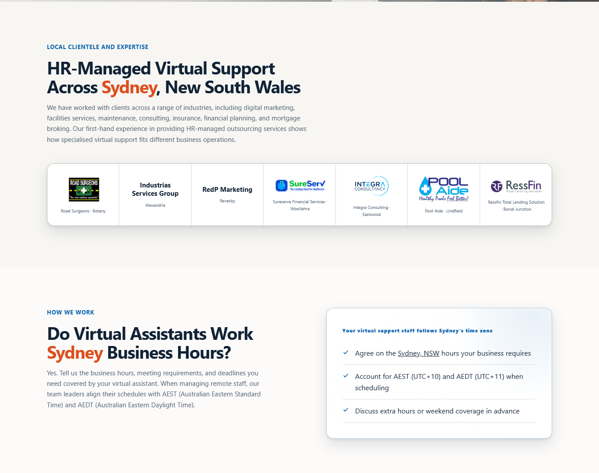
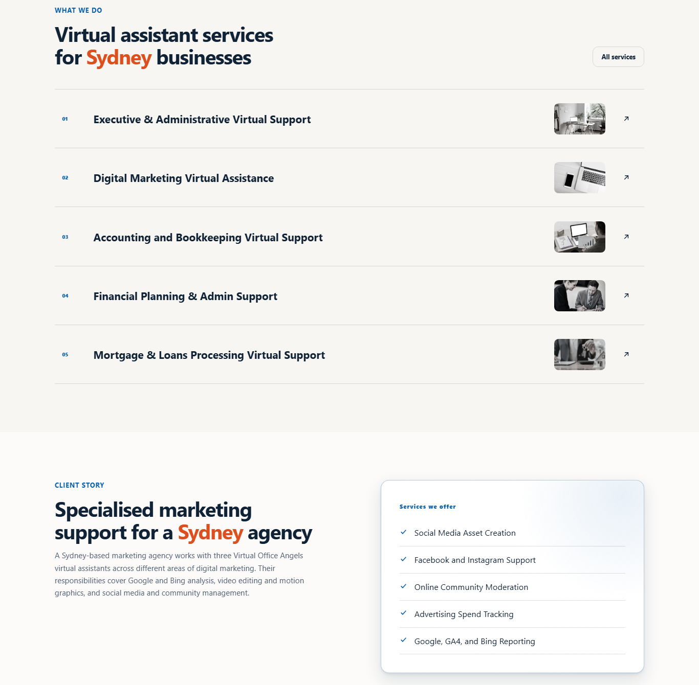
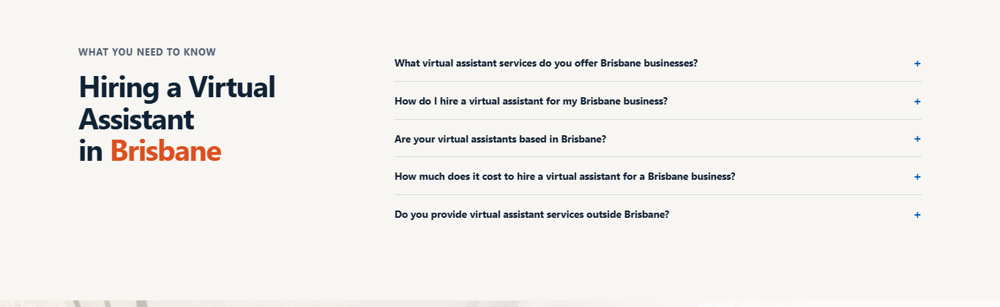
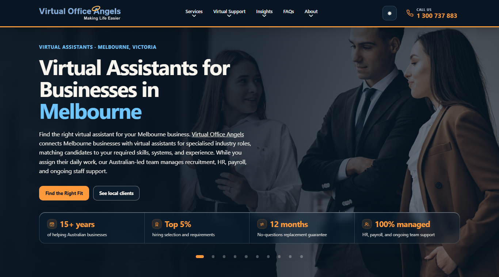
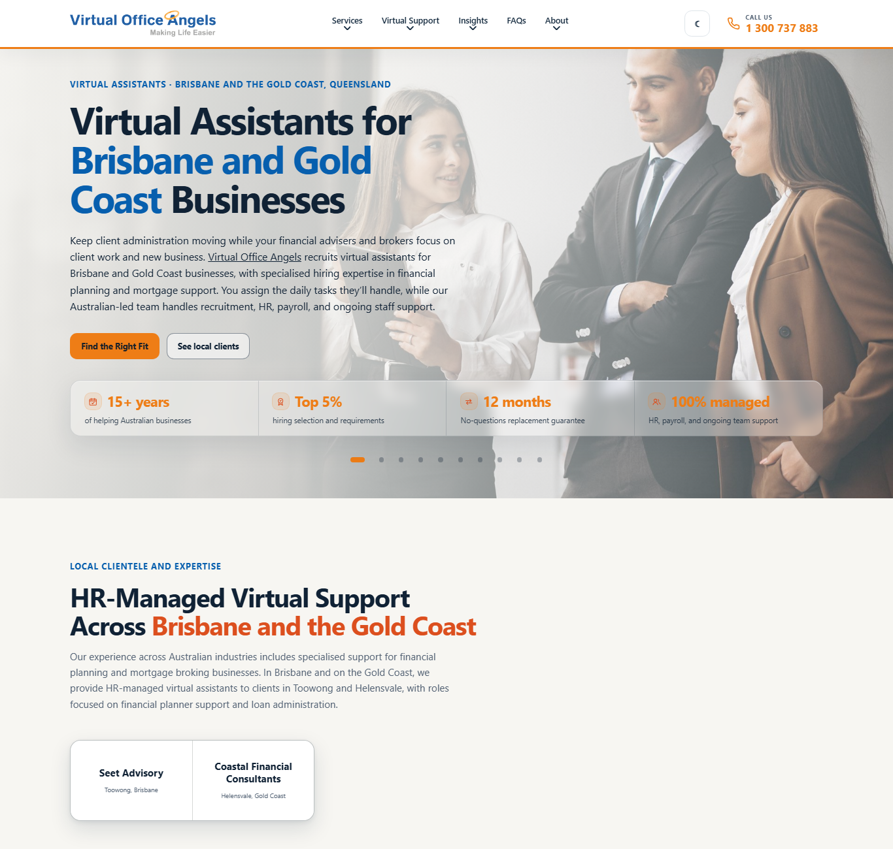

# Work summary: 27 October 2026

27 October 2026 · VA Mhari

Today's work on the Virtual Office Angels website: the latest article in the mockup, the city landing
pages rebuilt from the content writer's copy, the same pages built into the WordPress theme, and three
small fixes found while testing. A new theme ZIP is ready for VOA staging.

## 1. Latest article added to the mockup

**"Why Niche Roles Are Moving Into the Virtual Recruitment Market"**, published on the live site on
26 October, is now in the mockup: first on the Insights page (32 articles) and on its own page at
`/insights/niche-virtual-assistant-roles`. Its text, date, featured image and category were taken from
the live site.

- The mockup works out each article's category from its words, and would have called this one
  "Mortgage & loans". An article can now carry its real category, so this one shows **Virtual
  assistance**, as on the live site. The older articles still use the worked-out category.

## 2. City landing pages rebuilt from the writer's copy

The Sydney, Brisbane and Melbourne pages now use the content writer's three documents
(`VOA_<City>_Service Page Area Page_On-Page SEO Optimized.docx`) for every section: hero, local
clients, working hours, services, client story and FAQs. The layout, the four hero figures and the
closing contact section are unchanged.

| Change | Detail |
| --- | --- |
| New addresses | `/virtual-assistants-sydney`, `/virtual-assistants-brisbane`, `/virtual-assistants-melbourne`. The first mockup addresses redirect to them |
| SEO title and description | From the writer's documents. Shown in the browser tab in the mockup; seeded into Yoast in WordPress |
| Services | The writer's own cards and wording: Sydney 5, Brisbane 2, Melbourne 1, with H3 headings |
| Client story | A real story and a "Services we offer" list for each city. Sydney's replaces the Epping case study link |
| FAQs | Only the writer's questions: Sydney 4, Brisbane 5, Melbourne 5, with H3 question headings |
| Links | The writer's links to preview sites now point at the site's own pages. Government links open in a new tab |
| Client logos | Shown where the library has one; four clients show their name until their logo arrives (section 5) |

Decided with the user before building: the new addresses, only the writer's FAQs, and client names
until the logos are supplied.

**Checked:** lint, type-check and production build pass; all three pages checked on desktop, Melbourne
in dark mode, and the old addresses redirect.

**For the writer:** "authorized" in the Sydney and Brisbane mortgage cards; the rest of the copy uses
"authorised". Kept as written.

**Layout note:** as on every service list, a card's description appears on hover (always shown on
phones) and is cut at three lines, so the longer descriptions are shortened there.

## 3. City pages built into the WordPress theme

The theme now has the three city pages, so they can go on VOA staging.

- **One shared template** draws the three pages from the same copy as the mockup, exported by
  `npm run wp:export`, so the two cannot drift apart.
- **Appearance → Site setup** creates the three pages and fills in each page's Yoast SEO title and
  description from the writer's documents. It never changes existing pages or posts.
- **Website Content** has three new entries: **City page: Sydney**, **Brisbane** and **Melbourne**.
  Every heading, paragraph, list item and FAQ can be edited, and every client has a logo field.

**Tested on a local WordPress 7.1.3 with PHP 8.3 and Contact Form 7:**

- The comparison script reports all three city pages identical to the mockup.
- Site setup created the pages with the right Yoast titles.
- A test edit and a test logo on Sydney appeared on Sydney only, and restoring them brought the
  originals back.
- PHP lint passes on every theme file, and the error log stayed empty.

**Not tested:** on VOA staging itself, with Yoast installed, or on a real phone.

**Question answered:** uploading a new theme does **not** remove the article posted on VOA staging.
Articles, images, menus and Yoast settings live in WordPress's database; a theme upload only replaces
the theme's files.

## 4. Three mismatches fixed

Found by the comparison while testing, in pages built earlier:

| Page | Problem | Fix |
| --- | --- | --- |
| FAQs | WordPress replaced the page's closing line, "If you need any other clarification, call Virtual Office Angels or email…", with the contact section's text, because both used the same internal name | The FAQ line has its own name now (theme) |
| About | A straight apostrophe in "industry's", where the rest of the site uses ’ | Changed to ’ (mockup) |
| Client Stories | An icon in the case study diagram lacked its screen-reader marker | Added (theme) |

After the fixes, every page in the comparison is identical to the mockup, apart from the home and
Insights pages, which differ only because the test site has no articles.

## 5. Next steps on VOA staging

1. Back up the database: UpdraftPlus → **Backup Now**.
2. Upload `wordpress-theme/virtual-office-angels.zip`: Appearance → Themes → Add New → Upload Theme →
   **Replace current with uploaded**.
3. Run **Appearance → Site setup** once.
4. Open the three city pages and check their Yoast title and description.

The ZIP also carries every other theme change made since staging's last upload, so look over the other
pages after uploading.

## 6. Follow-up: client logos needed

The writer's documents ask for a logo for every client on the Sydney and Brisbane pages. Four are not
in the website's logo library, and two library logos need confirming.

**Logos needed:**

| # | Client | Location | Page |
| ---: | --- | --- | --- |
| 1 | Industrias Services Group | Alexandria | Sydney |
| 2 | RedP Marketing | Revesby | Sydney |
| 3 | Seet Advisory | Toowong, Brisbane | Brisbane |
| 4 | Coastal Financial Consultants | Helensvale, Gold Coast | Brisbane |

**Logos to confirm** (the library has a close match):

| # | Client on the page | Logo in the library |
| ---: | --- | --- |
| 5 | Sureserve Financial Services, Woollahra | "SureServ" |
| 6 | Integra Consulting, Eastwood | "Integra Consultancy" |

Velar Finance (Doncaster East, Melbourne) shows its name, as the writer asked. A logo can be added
later if wanted.

**What to send for each logo:** a PNG with a transparent background or an SVG, at least 400 pixels
wide, ideally the client's own file rather than a screenshot.

**How they go on:** send the files and they are added to the mockup and the next theme ZIP. On staging
they can also be added straight away under **Website Content → City page: Sydney** (or Brisbane) →
**Local clients** → the client's **Image** field → **Choose image**.
