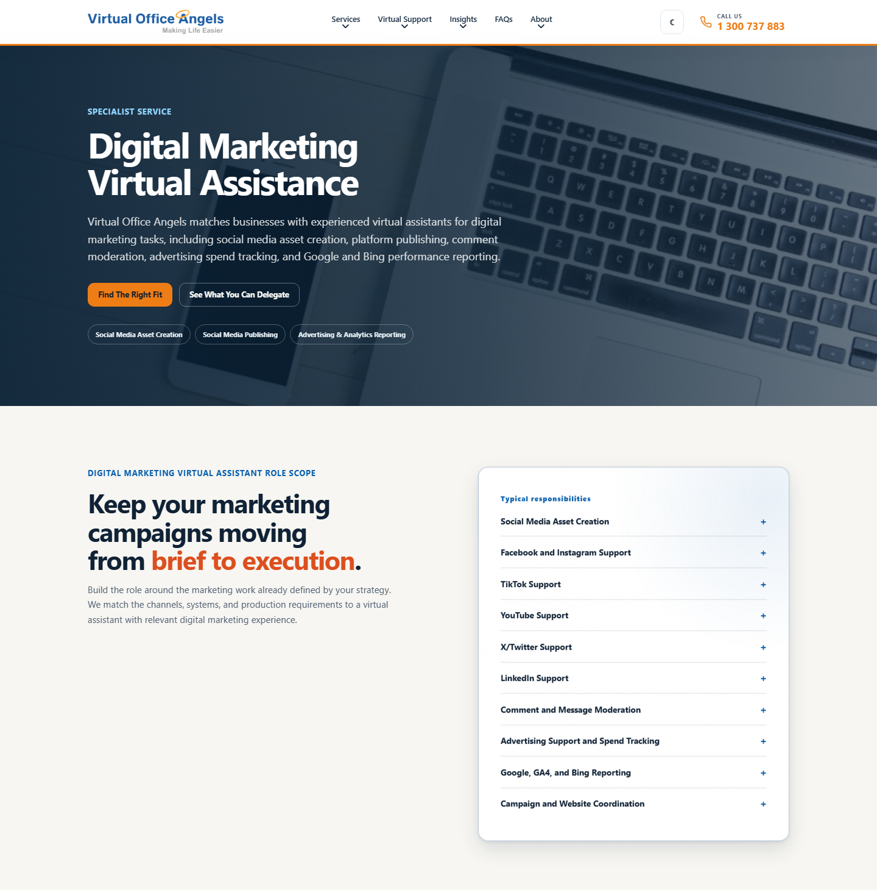
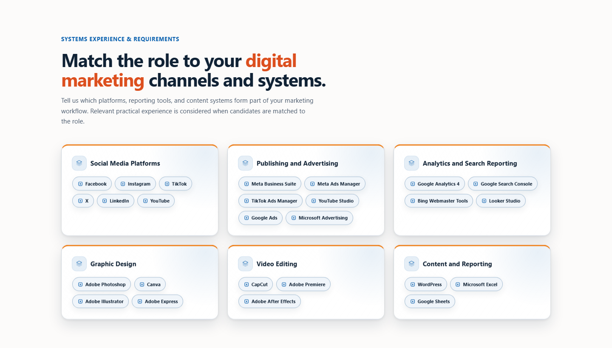
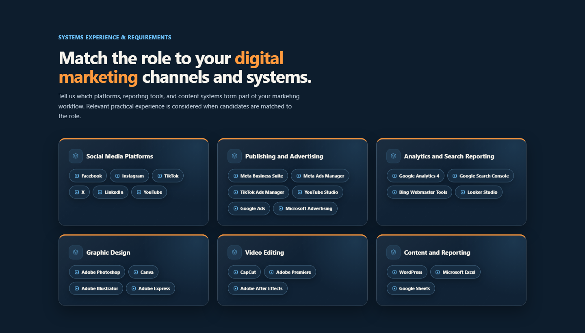
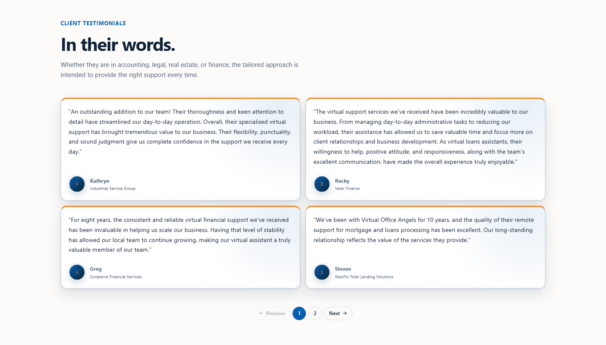
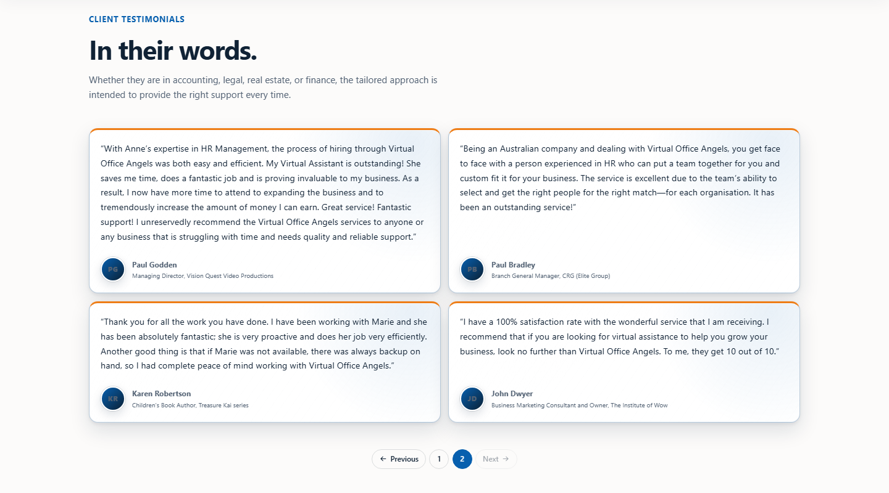
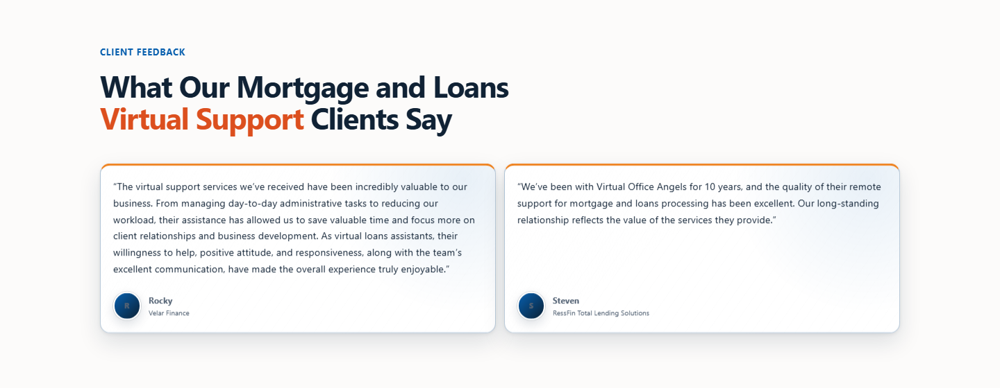
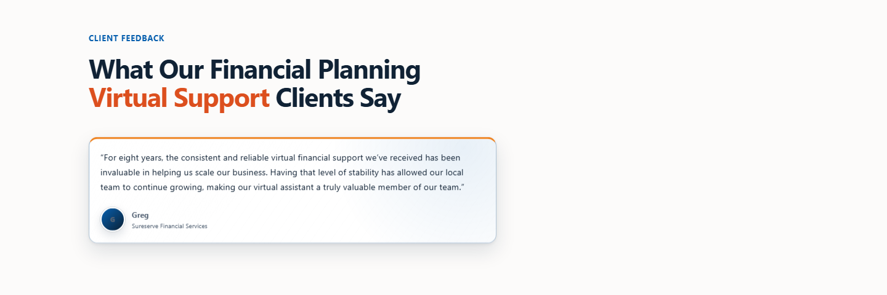
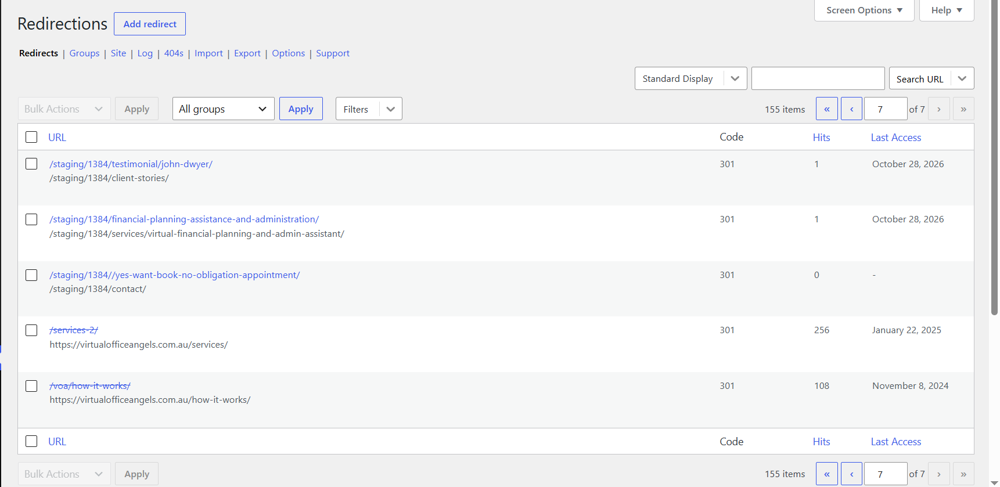
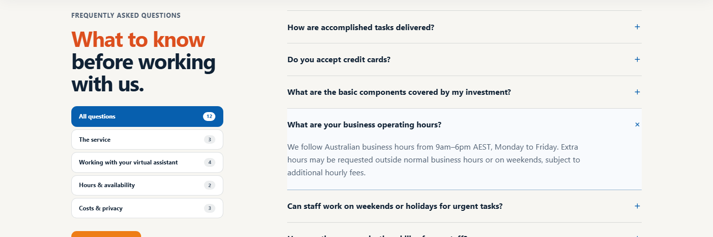

# Work summary: 28 October 2026

28 October 2026 · VA Mhari

Today's four tasks on the Virtual Office Angels website: the revised Digital Marketing service page,
the new client testimonials, the redirects set up and tested on VOA staging, and the business hours.
Each change is in the mockup and the WordPress theme, and the new theme is uploaded to VOA staging.

| # | Task | Result |
| ---: | --- | --- |
| 1 | Digital Marketing service page: revised content | Done, on staging |
| 2 | New client testimonials | Done, on staging |
| 3 | Redirects for the changed page addresses on VOA staging | Done: all 153 tested and working |
| 4 | Business hours: 9am–6pm across the website | Done, on staging |

## 1. Digital Marketing service page

From `VOA_Digital_Marketing Service Page_Updated_Content.docx`:

- **Hero:** the new description and the three new tags: Social Media Asset Creation, Social Media
  Publishing, and Advertising & Analytics Reporting.
- **Role scope:** the new heading, "Keep your marketing campaigns moving from brief to execution", and
  ten responsibilities instead of six: social media assets; Facebook and Instagram; TikTok; YouTube;
  X/Twitter; LinkedIn; comment and message moderation; advertising and spend tracking; Google, GA4
  and Bing reporting; and campaign and website coordination.
- **Systems:** the document groups the tools into six categories, so this page shows six cards
  (Social Media Platforms, Publishing and Advertising, Analytics and Search Reporting, Graphic Design,
  Video Editing, Content and Reporting) instead of the hub diagram. The other nine service pages keep
  the diagram.

After review, the cards were rebuilt to match the site's other cards: the same shadow, surface shade
and hover lift, the orange top rule of the testimonial cards, a tinted icon beside each heading, and
the tools as the same chips the diagram uses.

**Not in the document, so unchanged:** the SEO title and description, "When to hire", the outcomes,
the FAQs, and the managed support and closing sections.

## 2. New client testimonials

Four testimonials from the **Client Testimonials** tab of the action items tracker, using column H
(the SEO-keyword version):

| Client | Company | Shown on |
| --- | --- | --- |
| Kathryn | Industrias Service Group | Client Stories |
| Rocky | Velar Finance | Client Stories, Mortgage & Loans |
| Greg | Sureserve Financial Services | Client Stories, Financial Planning |
| Steven | RessFin Total Lending Solutions | Client Stories, Mortgage & Loans |

- **Client Stories:** the four new testimonials come first, before the four older ones. After review,
  the page now shows **four at a time** with page buttons (two pages), and each row is only as tall as
  its own quotes.
- **Service pages:** real feedback replaces the "Feedback is currently being gathered" placeholders on
  Mortgage & Loans (two) and Financial Planning (one). The grid fits the number of testimonials: two
  side by side, or one at a readable width. The other service pages keep the placeholders.
- **Home page:** unchanged; it keeps its three previews.
- **Company spelling:** "Industrias Service Group", as in the tracker, now also on the Sydney city
  page (it said "Services").

## 3. Redirects on VOA staging

Redirects send anyone using an old address (from Google or an old link) to the new page, instead of
"page not found".

- **153 redirects, not 30:** 53 old pages, testimonial, tag and category pages, and 100 articles. The
  15 and 26 October articles were added to the list today.
- **A separate staging file**, `redirects-staging-1384.csv`: the Redirection plugin matches the full
  address, so on staging every address needs `/staging/1384/` in front. The normal file,
  `redirects.csv`, is kept for live on launch day.
- **Step-by-step guide:** `docs/wordpress-integration/REDIRECTS_STAGING_GUIDE.txt`.

**Tested after the import:**

- All **153** answer with a single permanent redirect (301) to exactly the right address.
- All **117** pages they lead to load. (Several old addresses share a destination, such as the tag
  pages, which all go to Insights.)
- The 2 older redirects already on staging (`/services-2/` and `/voa/how-it-works/`) are switched
  off, do not clash with the new ones, and are left as they are.

## 4. Business hours

The confirmed hours are **9am–6pm**. The only place the website gave the hours was the FAQ answer
"What are your business operating hours?", which now reads: "We follow Australian business hours from
9am–6pm AEST, Monday to Friday…"

## Checks

- **Mockup:** lint, type-check and production build pass.
- **Theme:** PHP lint clean. On a local WordPress copy, every page matches the mockup (home and
  Insights differ only because that copy has no articles), and the testimonial page buttons were
  clicked through: Next, page 2, Previous.
- **Saved:** pushed to GitHub (`c5fc769`).

Not checked: hover effects, keyboard use of the page buttons, and a real phone.

## Follow-ups

1. **Google Business Profile:** change the hours to 9am–6pm (it says 9am–5:30pm).
2. **Before launch:** delete the "Staging test" redirect group on staging (guide step 9).
3. **Launch day:** import `redirects.csv` on live and test again (guide step 10).
4. **For the writer:** the first Digital Marketing FAQ answer still describes the old scope.
5. **Steven's testimonial:** confirm the edited wording ("remote support for mortgage and loans
   processing") reflects what he meant; his original email gave general praise only.
6. **Client logos** for the city pages are still outstanding (see the 27 October summary).
